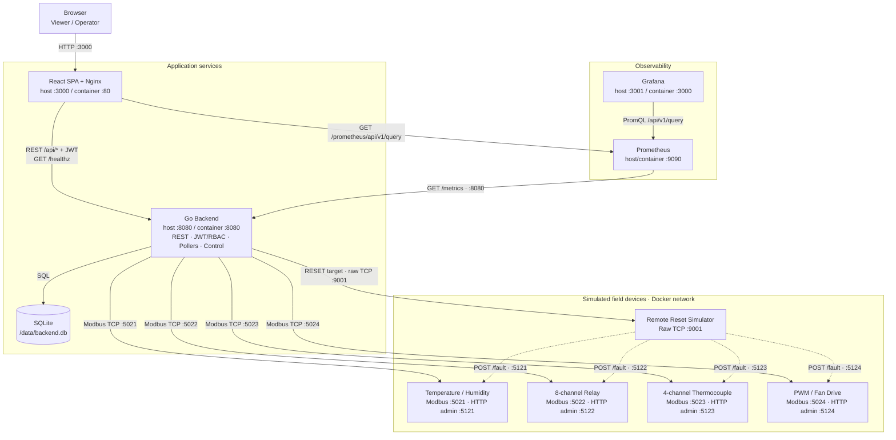
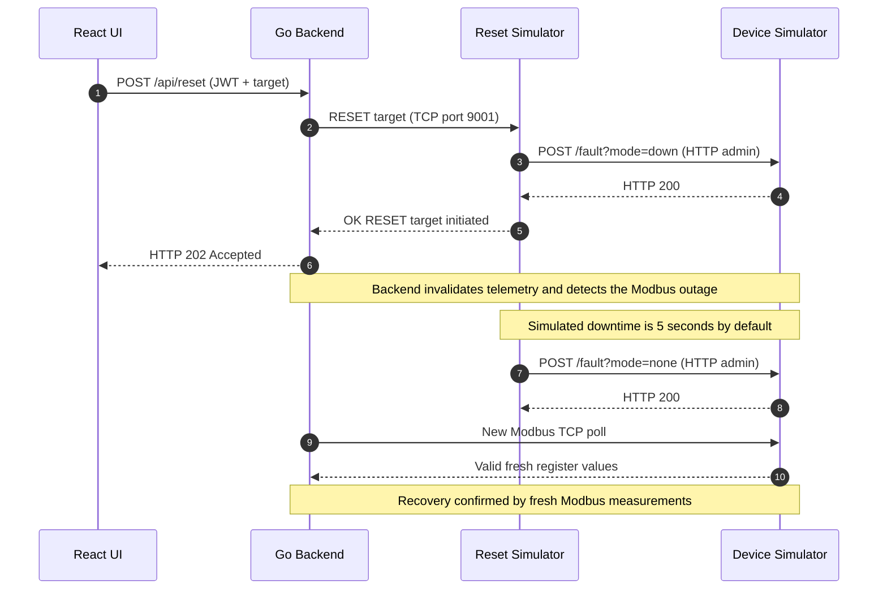

# Industrial Hardware Monitoring & Control Platform

**HWM Full-Stack Technical Assessment v3.1 — Go · React · Modbus TCP · SQLite · Prometheus · Grafana**

An end-to-end monitoring and control platform for independent simulated industrial devices. The device-facing backend is written in Go: it polls real Modbus TCP sockets, stores measurements, evaluates temperature-based hysteresis, verifies physical relay/PWM feedback, exposes authenticated control APIs, and exports Prometheus metrics. A React frontend provides live views and controls; a separate TCP reset simulator supports power-cycle workflows. The whole stack is described by Docker Compose.

## 1. Quick start

Requirements: Docker Desktop/Engine with Docker Compose. Python 3 is needed only for the optional HTTP/integration smoke scripts. Go and Node are not required to *start* the Docker stack.

From the **repository root**:

```bash
# Bash / Linux / macOS
cp .env.example .env
# Review .env and replace demonstration-only secrets before any nonlocal exposure.
docker compose config --quiet
docker compose up --build -d
docker compose ps
```

PowerShell equivalent for the first command:

```powershell
if (!(Test-Path .env)) { Copy-Item .env.example .env }
```

Do not overwrite an existing `.env`. Wait for health checks to settle; simulator dependencies are health-gated. Inspect failures with `docker compose logs --tail=100 backend` or `docker compose logs --tail=100 <service>`.

Open the [React application](http://localhost:3000), [Grafana dashboard](http://localhost:3001/d/hwm-industrial-overview), or [Prometheus targets](http://localhost:9090/targets). For the complete host/container port map and device interfaces, see [System architecture](#2-system-architecture).

**Security:** The demo Compose stack is intended for a trusted local network. Backend, frontend, Prometheus and Grafana host bindings are not restricted to loopback by default. Device admin HTTP and reset TCP ports are loopback-only.

To stop without destroying persistent measurements/monitoring data:

```bash
docker compose down
```

**Do not use `docker compose down -v`** unless you deliberately want to delete the named volumes.

### Demo credentials

The following **local test credentials** are defined in the committed `.env.example` file. After copying it to `.env`, use these accounts to exercise both access levels:

| Interface | Username | Password | Access |
|---|---|---|---|
| HWM application | `viewer` | `viewer-dev-pass` | Read-only monitoring |
| HWM application | `operator` | `operator-dev-pass` | Monitoring and authorized control |
| Grafana | `admin` | `example-pass` | Dashboard administration |

The Go backend reads `VIEWER_USERNAME`, `VIEWER_PASSWORD`, `OPERATOR_USERNAME`, `OPERATOR_PASSWORD` and `JWT_SECRET` from the environment. Grafana uses `GRAFANA_USER` (default `admin`) and `GRAFANA_PASSWORD`. **These are demonstration credentials only:** change them before using the stack outside an isolated local environment. Never commit the real `.env` file.

- **Viewer:** can access authorized monitoring surfaces; control actions are hidden/disabled in React and rejected by the Go API.
- **Operator:** can access monitoring and authorized relay, speed, threshold/mode and reset operations.

Authentication uses two environment-configured roles. Passwords are checked against bcrypt hashes in memory; the Go backend issues signed, one-hour JWTs and enforces capabilities on each protected API route. The UI returns to login when the token expires.

## 2. System architecture

The platform separates **user-facing HTTP APIs**, **industrial Modbus TCP communication**, and an independent **reset-management channel**. Each simulated field device exposes a Modbus socket for telemetry/control and a separate HTTP administration socket for local fault injection. The reset simulator uses those administration sockets; it does **not** reuse the backend's Modbus connections.

### Component and network diagram



**Network boundaries:** Modbus ports `5021`–`5024` are available only on the Compose network. HTTP simulator administration ports `5121`–`5124` and reset TCP `9001` are also published on the host's `127.0.0.1` interface for local tests. Browser requests go through Nginx; the Go backend talks directly to devices over Docker-internal sockets.

### Ports and interfaces

| Service | Host access | Docker-internal address | Protocol / purpose |
|---|---|---|---|
| Frontend (Nginx + React) | `http://localhost:3000` | `frontend:80` | HTTP SPA, `/api/*` reverse proxy |
| Go backend | `http://localhost:8080` | `backend:8080` | HTTP REST, `/healthz`, `/metrics` |
| Temperature/Humidity | Not published | `temp-humidity-sim:5021` | Modbus TCP, FC4 sensor values |
| Relay | Not published | `relay-sim:5022` | Modbus TCP, FC1/FC5/FC15 coils |
| Thermocouple | Not published | `thermocouple-sim:5023` | Modbus TCP, FC4 channels |
| PWM / Fan drive | Not published | `speed-pwm-sim:5024` | Modbus TCP, FC3/FC6/FC16 |
| Sensor admin | `127.0.0.1:5121` | `temp-humidity-sim:5121` | HTTP, `/state`, `/fault`, `/temp` |
| Relay admin | `127.0.0.1:5122` | `relay-sim:5122` | HTTP, `/state`, `/fault` |
| Thermocouple admin | `127.0.0.1:5123` | `thermocouple-sim:5123` | HTTP, `/state`, `/fault`, `/channel-fault`, `/channel-unpin` |
| PWM admin | `127.0.0.1:5124` | `speed-pwm-sim:5124` | HTTP, `/state`, `/fault`, `/feedback` |
| Remote reset | `127.0.0.1:9001` | `remote-reset-sim:9001` | Raw TCP, `PING`, `STATUS`, `RESET` |
| Prometheus | `http://localhost:9090` | `prometheus:9090` | HTTP metrics collection / PromQL |
| Grafana | `http://localhost:3001` | `grafana:3000` | HTTP dashboards |

Host ports are configurable via `FRONTEND_PORT` (default `3000`), `BACKEND_PORT` (`8080`), `PROMETHEUS_PORT` (`9090`) and `GRAFANA_PORT` (`3001`). The admin and reset ports are fixed loopback bindings in the supplied Compose file.

### Request and control paths

| Operation | Request path | Backend / device interaction |
|---|---|---|
| Login | `POST /api/auth/login` | Go validates credentials and issues a JWT |
| Live measurements | `GET /api/measurements?source=sensor` | Backend reads the latest stored/validated Modbus samples |
| Relay control | `POST /api/relays/{id}` | Go writes the coil over Modbus and confirms read-back |
| Fan speed | `GET/POST /api/fan/speed` | Go reads/writes PWM registers and checks RPM feedback |
| Fan configuration | `GET/PUT /api/config/control` | Go updates hysteresis, AUTO/MANUAL and selected relay |
| Thermocouple | `GET /api/thermocouple` | Four independent channels with per-channel fault state |
| Device reset | `POST /api/reset` | Go → raw TCP `RESET <target>` → reset simulator → HTTP admin `/fault` |
| Live metrics | `GET /metrics` | Prometheus scrapes the Go backend every 2 seconds |
| Dashboard query | `GET /prometheus/api/v1/query` | Nginx forwards read-only PromQL queries to Prometheus |

### Remote reset sequence



A successful reset TCP acknowledgment means the reset sequence was initiated; device recovery is determined independently from subsequent valid Modbus reads.

### Source layout

| Directory | Responsibility |
|---|---|
| `backend/cmd/backend/` | Startup, dependencies, pollers and HTTP lifecycle |
| `backend/internal/poller/` | Device polling, retries, health and reset generations |
| `backend/internal/control/` | Hysteresis, AUTO/MANUAL and relay/PWM coordination |
| `backend/internal/relay/`, `speed/`, `reset/` | Modbus and raw TCP protocol clients |
| `backend/internal/auth/`, `api/` | JWT authorization, REST endpoints and metrics |
| `backend/internal/store/` | SQLite persistence |
| `simulators/cmd/`, `simulators/internal/` | Four Modbus devices and the remote-reset process |
| `frontend/src/` | React dashboard and HTTP polling |
| `observability/` | Prometheus configuration and Grafana dashboards |
| `scripts/` | Smoke, fault recovery and hysteresis integration tests |

## 3. Implemented features

| Requirement | Implementation |
|---|---|
| **§2.1 Sensor (Core)** | Independent Modbus TCP sensor; 18–35 °C / 30–80% RH bounded random walk; FC4; two-second polling; timestamped SQLite measurements; fault injection, retry/backoff and honest status |
| **§2.2 Relays (Core)** | Eight coils with configurable labels, Modbus write followed by coil read-back, distinct error conditions and authenticated control |
| **§2.4 Go backend (Core)** | Device-facing Go packages, goroutine pollers, state snapshots, mutexes, cancellation and error handling |
| **§2.5 Hysteresis (Core)** | Configurable upper/lower thresholds, strict transition rules, sensor freshness, read-back reconciliation, runtime edits and audit events |
| **§2.7 React UI (Core)** | JWT login, monitoring graphs, device status, relays, thresholds/mode, thermocouple/PWM/reset controls and capability-aware rendering |
| **§2.8 Prometheus/Grafana (Core)** | Go metrics endpoint, two-second scrape configuration, automatically provisioned Grafana dashboard, Prometheus-origin temperature shown in React |
| **§2.10 JWT/RBAC (Core)** | Viewer/operator roles, bcrypt passwords, signed expiring JWTs, 401/403 and capability-guarded actions |
| **§2.3 Thermocouple (Extended)** | Four independently tagged channels, signed tenth-degree decoding, explicit `0x8000` faults, live/fault/unknown API and React display |
| **§2.6 Variable-speed fan (Extended)** | Modbus PWM with command read-back and independent tachometer RPM, MANUAL/AUTO, reference speed curve and persistent mismatch reporting |
| **§2.9 Remote reset (Extended)** | Independent TCP reset server, four allowed targets, verified JWT actor, audit, explicit React confirmation, invalidation and recovery verification |

## 4. Modbus register maps and reset protocol

The following register maps are project-specific; they are not vendor maps.

| Device | Modbus TCP socket | Function / address | Semantics |
|---|---|---|---|
| Temperature/Humidity | `temp-humidity-sim:5021` | FC4 input registers `0`, `1` | Temperature ×10 °C; humidity ×10 %RH |
| Relay card | `relay-sim:5022` | FC1 coils `0..7`; FC5/FC15 writes | Eight independently addressable loads; read-back is authoritative |
| Thermocouple | `thermocouple-sim:5023` | FC4 input registers `0..3` | Signed `int16` tenths °C; `0x8000` means channel fault |
| PWM/Fan drive | `speed-pwm-sim:5024` | FC3 holding `0`,`1`; FC6/FC16 writes | Register 0: command 0–100%; register 1: measured 0–3000 RPM |

Thermocouple sources are `thermocouple_ch0` through `thermocouple_ch3`, persisted separately. Faults do **not** generate zero-valued measurements, and `last_valid_at` remains the prior valid timestamp. Transport faults make current channel values unknown. The thermocouple module may be online even if all four probes report faults.

The reset service accepts `PING`, `STATUS` and `RESET <target>` via **raw TCP**. Valid targets are `temp-humidity`, `relay`, `thermocouple`, and `speed-pwm`. A reset causes simulated downtime (Compose default five seconds) and recovery attempts. Backend telemetry is invalidated and must be restored from subsequent verified device reads, not from a guessed status.

### Relay labels

`RELAY_LABELS_FILE` selects a JSON label file read by the **Go backend at startup**; otherwise built-in channel labels are used. When using Compose, provide both the environment variable **and a readable file mount**, for example using a local override:

```yaml
services:
  backend:
    environment:
      RELAY_LABELS_FILE: /app/relay-labels.json
    volumes:
      - ./relay-labels.json:/app/relay-labels.json:ro
```

This wiring is **not part of the base `docker-compose.yml`**. The file contains a JSON **array of 1–8 strings**, for example `["Fan 1", "Heater", "Lighting", "Aux Power"]`; changing labels requires backend restart, not a source-code edit.

## 5. Fan control behavior

Initial configuration: AUTO mode, `on_above=30` °C, `off_below=27` °C, fan on relay channel 0. These values may be changed at runtime and are persisted in SQLite.

- **AUTO hysteresis:** temperature strictly above `on_above` switches the configured relay ON; strictly below `off_below` switches it OFF; between the thresholds (including boundaries) the confirmed previous state is held.
- **Hardware confirmation:** the engine reads the actual fan coil before decisions; completed writes are confirmed by read-back. Failed operations are surfaced and logged.
- **Safety and freshness:** stale, implausible or unavailable sensor values suspend automation; the last fan state is held rather than forcibly switched OFF. This is **not** an independent hardware safety interlock.
- **MANUAL:** operators with `write:relay` may write the fan coil and use `write:fan_speed` for manual PWM commands. AUTO rejects direct writes to the owned fan channel or speed with HTTP `409`.
- **PWM AUTO:** hysteresis remains authoritative. Confirmed relay OFF commands 0%; when ON, the reference is `clamp(round(20 + 8 × (T − 25)), 0, 100)` percent: 20% at 25 °C and 100% at 35 °C.
- **RPM divergence:** command and actual tachometer feedback are separate readings. A difference of more than 300 RPM is reported as persistent only after settling and sustained divergence windows (five seconds each).

Device writes, mode changes and reset invalidation share a controller operation mutex. Sensor/poller generations reject obsolete reset-cycle samples. Status is represented honestly as online, degraded, offline, recovering, recovery failed or unknown where appropriate.

## 6. REST API and authorization

With the exception of login, health and Prometheus exposition, routes require a valid JWT. The backend verifies capabilities independently of which controls React displays.

| Method | Endpoint | Required capability | Notes |
|---|---|---|---|
| POST | `/api/auth/login` | Public | `{"username":"...","password":"..."}` → JWT token and expiration |
| GET | `/api/auth/me` | Valid JWT | Username, role and issued permissions |
| GET | `/api/devices` | `read:device_status` | Current connectivity/status per device |
| GET | `/api/measurements` | By `source` | `sensor`/empty → `read:sensor`; `thermocouple_ch0..3` → `read:thermocouple`; `fan_speed` → `read:fan_speed` |
| GET | `/api/relays` | `read:relay` | Actual coil channel read-back; may return 503 during reset |
| POST | `/api/relays/{id}` | `write:relay` | Body `{"on":true}`; fan in AUTO → 409 |
| GET | `/api/config/control` | `read:events` | Current config and controller snapshot |
| PUT | `/api/config/control` | `write:thresholds` | Partial config body; merges/persists under serialized control lock |
| GET | `/api/events` | `read:events` | Recent audit/status events; optional `limit` |
| GET | `/api/thermocouple` | `read:thermocouple` | Four live/fault/unknown channels, nullable temperature and all-fault flag |
| GET | `/api/fan/speed` | `read:fan_speed` | PWM command %, actual RPM and mismatch |
| POST | `/api/fan/speed` | `write:fan_speed` | `{"percent":50}`; AUTO → 409 |
| POST | `/api/reset` | `write:reset` | `{"target":"relay"}`; accepted request → 202; confirmation is required in React |
| GET | `/healthz` | Public | Backend process health, **not** a guarantee all devices are online |
| GET | `/metrics` | Public | Prometheus exposition; restrict network exposure |

Missing/invalid/expired credentials return `401`; authenticated callers lacking a required capability receive `403`. Unknown measurement sources return `400`. Other errors may include `400`, `404`, `409`, `502`, `503`, or `504` depending on the operation and device availability.

Capabilities enforced by the Go API: `read:sensor`, `read:relay`, `read:thermocouple`, `read:fan_speed`, `read:events`, `read:device_status`, `write:relay`, `write:fan_speed`, `write:thresholds`, and `write:reset`.

## 7. Persistence

SQLite uses one logical database (`DB_PATH`, Compose volume `/data/backend.db`) and separate tables:

- `measurements`: timestamped `source`, `metric` and numeric value, including the four thermocouple source tags and PWM telemetry.
- `events`: timestamped audit entries (`kind`, `source`, `message`, `actor`) for actions, control transitions and device status.
- `device_states`: last observed state, last successful read, error and consecutive failures. On restart, current authorization/control does **not** trust a formerly persisted online status.
- `config`: saved control configuration and its last updater.

The measurement batch from a successful poll is transactional. Configuration writes and their event records are **separate SQL operations**; full atomic audit durability is not claimed. There is no automatic long-term retention/downsampling job.

## 8. Observability: Prometheus and Grafana

Prometheus scrapes `http://backend:8080/metrics` every two seconds. Grafana automatically provisions its Prometheus datasource and the dashboard at:

`http://localhost:3001/d/hwm-industrial-overview`

The dashboard contains **38 data panels plus six section rows (44 JSON panel entries)**:

1. **System Overview:** per-device state, AUTO/MANUAL and loop status, fan coil, environmental values, PWM/RPM, active faults.
2. **Environmental Monitoring:** temperature with live threshold histories, humidity, sensor availability.
3. **Fan and Relay Control:** eight coil states, ON/OFF timeline, commanded PWM, RPM and mismatch.
4. **Thermocouple Monitoring:** per-channel temperatures, faults, current state and last valid reading age.
5. **Device Diagnostics:** availability, consecutive errors, poll success/failure, classified Modbus errors, latency quantiles and event counters.
6. **Remote Reset Operations:** attempts, TCP acknowledgments/failures and recovery outcomes.

Selected metric families:

| Family | Semantics |
|---|---|
| `hwm_device_online{device}` | Stable device identity, 1 online / 0 otherwise; **no changing `state` label** |
| `hwm_device_state_code{device}` | 0 unknown, 1 online, 2 degraded, 3 offline, 4 recovering, 5 recovery failed |
| `hwm_device_consecutive_failures{device}` | Count of sequential failed polls |
| `hwm_sensor_temperature_celsius`, `hwm_sensor_humidity_percent` | Fresh ambient values only |
| `hwm_control_threshold_celsius{bound}` | ON/OFF thresholds |
| `hwm_control_auto_enabled`, `hwm_control_suspended`, `hwm_control_state_code` | Distinguishes MANUAL, AUTO ACTIVE and AUTO SUSPENDED |
| `hwm_control_fan_on`, `hwm_relay_channel_state{channel,label}` | Verified physical relay state |
| `hwm_fan_speed_command_percent`, `hwm_fan_speed_feedback_rpm`, `hwm_fan_speed_mismatch` | PWM command, tachometer and persistent mismatch |
| `hwm_thermocouple_temperature_celsius{channel}`, `hwm_thermocouple_fault{channel}`, `hwm_thermocouple_state_code{channel}` | Independent per-channel telemetry/quality |
| `hwm_thermocouple_last_valid_timestamp_seconds{channel}` | Last verified value timestamp |
| `hwm_modbus_polls_total{device,result}`, `hwm_modbus_errors_total{device,reason}` | Poll results and bounded error categories |
| `hwm_modbus_poll_duration_seconds{device}` | Prometheus histogram for polling duration |
| `hwm_reset_total{target,result}`, `hwm_reset_recovery_total{target,result}` | Submitted commands and separately verified recovery results |
| `hwm_control_errors_total{operation}`, `hwm_operational_events_total{kind}` | Control failures and committed audit events |

Unknown/unavailable measurements are **not** intentionally exported as fresh zeroes. Live samples are limited by six-second freshness checks; missing values appear as gaps, not fabricated data. Metric counters reset when the Go process restarts. The React application also shows a metric sourced through Nginx's read-only `/prometheus/api/v1/query` proxy, not a duplicated REST sensor endpoint.

## 9. Simulator fault injection (local testing only)

Admin HTTP endpoints are not protected by JWT and are intended for localhost testing only. Examples:

```bash
# Sensor: none, slow, timeout, error, garbage, malformed, down
curl -X POST 'http://127.0.0.1:5121/fault?mode=down'
curl -X POST 'http://127.0.0.1:5121/fault?mode=none'
curl -X POST 'http://127.0.0.1:5121/fault?mode=malformed'
curl -X POST 'http://127.0.0.1:5121/temp?value=31'
curl -X POST 'http://127.0.0.1:5121/temp?value=auto'

# Thermocouple channel 1 fault and restore
curl -X POST 'http://127.0.0.1:5123/channel-fault?ch=1&broken=true'
curl -X POST 'http://127.0.0.1:5123/channel-fault?ch=1&broken=false'

# PWM persistent disagreement and recovery
curl -X POST 'http://127.0.0.1:5124/feedback?rpm=0'
curl -X POST 'http://127.0.0.1:5124/feedback?rpm=auto'
```

`malformed` mode uses a separate TCP responder that returns a deliberately truncated Modbus read frame. Fault injection can change physical-state simulations and automatic controller behavior; run it on an isolated development stack and restore state afterward.

## 10. Testing and verification

The application starts using Docker Compose alone, as shown in [Quick start](#1-quick-start). Go and Node.js are only needed on the host when running their respective tests outside containers; Python is only needed for the optional integration scripts.

### Go unit tests, vet and race detector

With a local Go 1.26 toolchain:

```bash
(cd backend && go test -count=1 ./... && go vet ./... && go test -race ./...)
(cd simulators && go test -count=1 ./... && go vet ./... && go test -race ./...)
```

Or run race tests without installing Go on the host (from repository root, PowerShell):

```powershell
docker run --rm -v "${PWD}:/src" -w /src/backend golang:1.26 go test -race ./...
docker run --rm -v "${PWD}:/src" -w /src/simulators golang:1.26 go test -race ./...
```

### Frontend tests and production build

With Node.js available locally:

```bash
cd frontend
npm ci
npm test
npm run build
```

Or run tests in a temporary Node container without creating `frontend/node_modules` on the host (PowerShell, from repository root):

```powershell
docker run --rm -v "${PWD}/frontend:/app" -v /app/node_modules -v /app/dist -w /app node:20-alpine sh -c "npm ci && npm test && npm run build"
```

### End-to-end integration tests

With the Compose stack running, execute these Python scripts sequentially from repository root:

```bash
python scripts/smoke_test.py
python scripts/hysteresis_integration.py
python scripts/fault_recovery_integration.py --max-wait 150
python scripts/extended_smoke_test.py
```

The integration suite covers JWT and role permissions, Modbus relay read-back, temperature hysteresis, independent thermocouple channels, AUTO/MANUAL PWM behavior, mismatch detection, fault injection, remote reset and fresh-data recovery. Go race tests for both modules have also been exercised successfully. For final UI verification, check the combined fan control card, Grafana dashboards and live reset state in the browser.

## 11. Design decisions and known limitations

The implementation prioritizes the complete device-facing Go platform, real Modbus TCP communication, reliable control/read-back, observability and a reproducible Docker deployment. The following scope decisions and operational boundaries are intentional:

- **Identity and authorization:** The platform implements the Core viewer/operator JWT model in Go. The admin-managed Django identity service (§2.11), dynamic capability grants, RS256 token issuance and refresh flow were left out because §2.11 is an Extended requirement. The Go API still enforces route-specific read/write capabilities for its two configured roles.
- **Real-time delivery:** React uses approximately two-second REST polling instead of WebSocket/SSE. Polling keeps the implementation straightforward while meeting the assessment's accepted real-time delivery option.
- **Database and audit:** SQLite avoids an additional database service and supports transactional measurement batches. Configuration changes and their audit events use separate database operations, so those two writes are not guaranteed to commit atomically. No automated historical retention/downsampling job is configured.
- **Deployment and authentication:** Docker Compose is configured for local evaluation rather than public production exposure. Demo credentials, published HTTP endpoints and simulator fault-injection interfaces require additional hardening before deployment to an untrusted network. JWTs expire after one hour; users log in again rather than refreshing a token.
- **Safety boundary:** Software hysteresis, Modbus read-back and freshness checks are monitoring/control mechanisms, not substitutes for independent hardware safety interlocks.
- **Additional bonus features:** Alert delivery, Modbus RTU, OpenTelemetry tracing and named capability presets were not pursued; effort was focused on the tested Modbus TCP devices, fault recovery, fan control and remote reset workflows.

## 12. Submission hygiene

Keep source code, Dockerfiles/Compose, `.env.example`, Grafana provisioning/dashboard, tests, `README.md`, and [`AI_USAGE.md`](AI_USAGE.md). **Do not package `.env`, `.git`, private tokens, local databases, compiled binaries, `node_modules` or generated frontend assets.** Commit intended source changes before producing a clean-checkout submission archive.

For AI assistance disclosures see [`AI_USAGE.md`](AI_USAGE.md).
